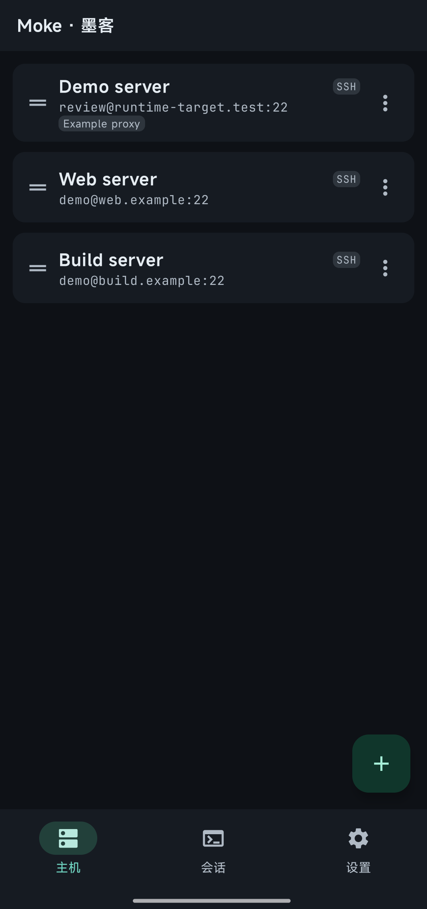
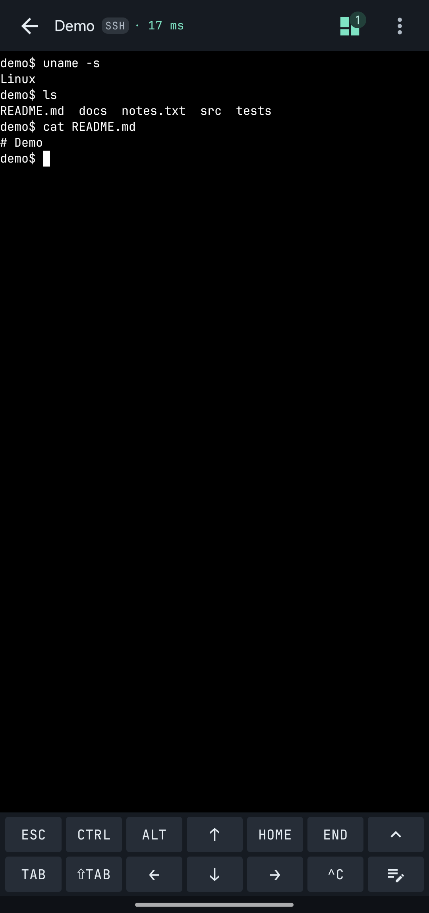
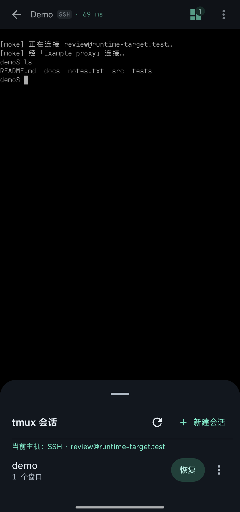
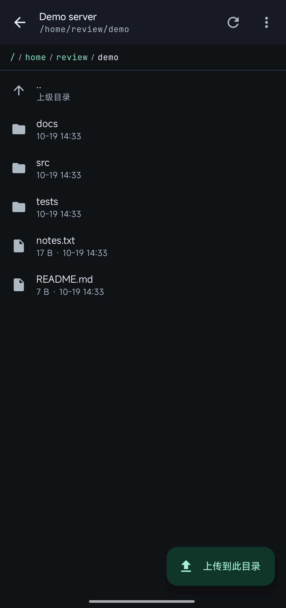
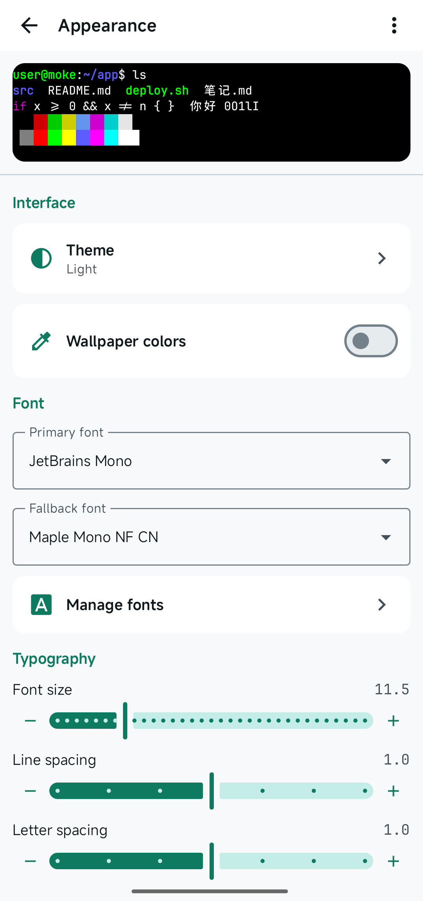

# Moke · 墨客

**Android 原生 SSH / mosh 终端，内置 Tailscale，支持代理、多会话、tmux 和 SFTP。**

<a href="README.md">English</a> · <b>简体中文</b>

## 功能

- **SSH / mosh**：密码与 PEM 私钥认证、主机密钥指纹确认、SSH 跳板机、按主机配置启动命令。
- **内置 Tailscale**：连接 tailnet 中的主机，支持官方与自建控制服务器、Tailscale IP 和 MagicDNS 主机名。用户态客户端不占用系统 VPN。
- **代理**：支持 HTTP / HTTPS / SOCKS4 / SOCKS5，可按主机选择使用的网络。
- **会话与 tmux**：多会话、后台连接、远端 tmux 会话管理，以及仅监听设备本机回环接口的端口转发。
- **文件**：SFTP 目录浏览、支持断点续传的上传下载、发送文件路径到终端。
- **终端**：可自定义附加键、输入法输入、文本段输入、链接、剪贴板与通知、字体和配色、中英双语界面。

网络凭据与 tailnet 登录状态经 Android Keystore 加密保存。

## 使用内置 Tailscale

1. 在「设置 → 网络」添加 Tailscale，选择官方或自建控制服务器并完成登录。
2. 编辑主机，在「网络」中选择该 Tailscale 网络，地址填写目标主机的 Tailscale IP 或 MagicDNS 名称。

内置网络仅供 Moke 的连接使用，不为其他应用提供网络接入；SSH 认证仍使用主机配置的密码或私钥。

## 截图

&nbsp;&nbsp;&nbsp;&nbsp;
 主机 · 终端 · tmux 面板 · 远端文件 · 外观（浅色主题）

## 安装

需要 **Android 11 及以上**、**arm64-v8a** 设备。从 [Releases](https://github.com/briqt/moke/releases) 下载 APK，按系统提示允许安装。发布包使用固定签名，可覆盖升级。应用内默认检查正式版，可在设置中开启包含预览版。

mosh 需要远端安装 `mosh-server`，且 UDP 数据通路可达。经代理使用时，需 SOCKS5 服务端支持 UDP 转发；HTTP、HTTPS 与 SOCKS4 代理不能承载 mosh。SSH 跳板机只承载引导连接，不转发 mosh UDP 数据，目标仍需 UDP 直达。会话能否持续还受网络可用性与 Android 后台限制影响。

## 构建与反馈

构建条件、命令与发布规范统一见 [CONTRIBUTING](CONTRIBUTING.zh-CN.md)。问题请通过 [issue](https://github.com/briqt/moke/issues) 反馈，暂不接受 PR。

## 许可

产品层（`app/`）采用 **GPL-3.0-or-later**，见 [LICENSE](LICENSE) 与 [COPYRIGHT.md](COPYRIGHT.md)。内置的终端模块为 Apache-2.0，独立运行的 mosh 可执行文件为 GPLv3。组件来源、修改说明与字体许可见 [THIRD_PARTY_NOTICES.md](THIRD_PARTY_NOTICES.md)。分发时须遵守各组件许可及对应源码提供义务。
